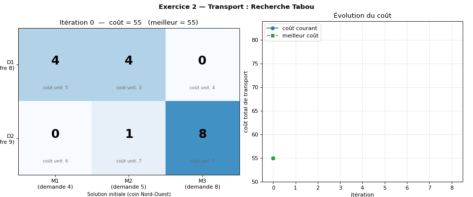
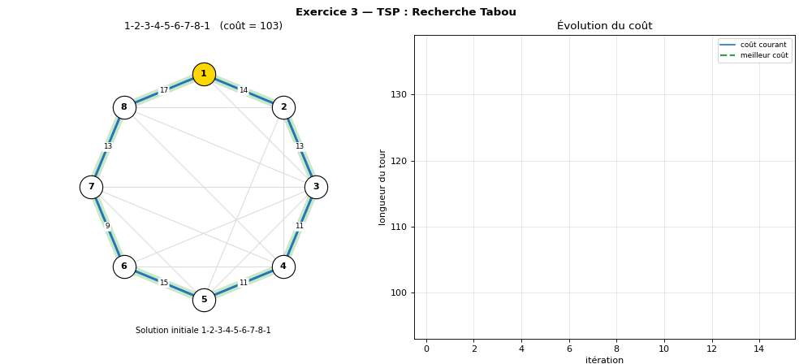
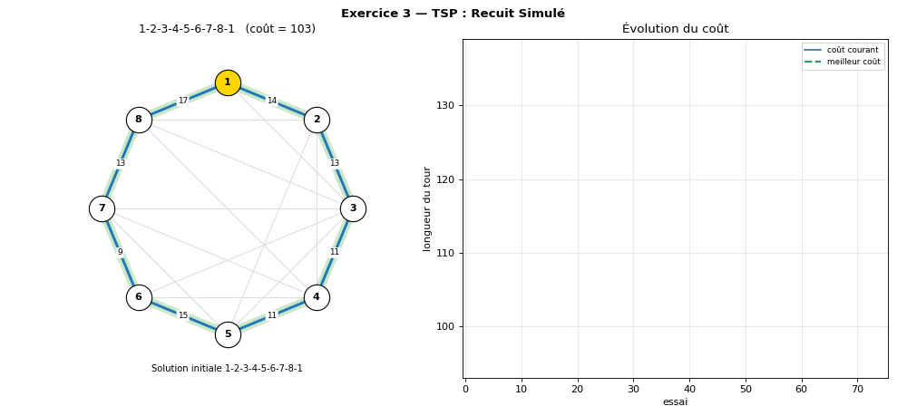

# 🔍 Métaheuristiques — Recherche Tabou & Recuit Simulé

TD (Travaux Dirigés & Rendu) — **Faculté des Sciences de Sfax**, Université de Sfax.

Implémentation en **Python** + **animations matplotlib** de :

| Exercice | Problème | Algorithme(s) |
|---|---|---|
| **2** | Transport de containers dépôts → magasins | Recherche Tabou |
| **3** | Voyageur de commerce (8 villes, graphe non complet) | Recherche Tabou · Recuit Simulé |

> L'algorithme génétique (question 3 de l'exercice 3) n'est volontairement pas inclus ici.

---

## 📁 Structure du projet

```
.
├── main.py              # point d'entrée : choix de l'algorithme à lancer
├── tabou.py             # Recherche Tabou (Ex.2 transport + Ex.3 TSP)
├── recuit_simule.py     # Recuit Simulé (Ex.3 TSP)
├── visualisation.py     # animations matplotlib + export GIF/MP4
├── donnees.py           # données des exercices
├── requirements.txt
└── assets/              # captures / GIF / vidéos pour ce README
```

## ▶️ Installation et exécution

```bash
pip install -r requirements.txt
python main.py
```

Menu interactif :

```
1) Exercice 2 : Transport            → Recherche Tabou
2) Exercice 3 : Voyageur de commerce → Recherche Tabou
3) Exercice 3 : Voyageur de commerce → Recuit Simulé
0) Quitter
```

Lancement direct (sans menu) :

```bash
python main.py 1            # Ex.2 – Tabou
python main.py 2            # Ex.3 – Tabou
python main.py 3            # Ex.3 – Recuit simulé
python main.py 3 --gif      # + enregistre assets/ex3_recuit.gif
python main.py 3 --mp4      # + enregistre assets/ex3_recuit.mp4 (ffmpeg requis)
python main.py 3 --no-show  # sans ouvrir la fenêtre matplotlib
```

---

## 🎬 Démonstrations

### Exercice 2 — Transport (Tabou)


### Exercice 3 — TSP (Tabou)


### Exercice 3 — TSP (Recuit Simulé)


### 📹 Vidéo de présentation *(à ajouter)*
<!-- Option 1 : glisser-déposer un .mp4 dans l'éditeur GitHub du README, GitHub génère le lien -->
<!-- Option 2 : lien YouTube : [](https://youtu.be/XXXXXXXX) -->

> 🎥 *Emplacement réservé : vidéo de démonstration (≈ 2 min) de `python main.py`.*

### 🖼️ Captures d'écran supplémentaires *(à ajouter)*

| Menu console | Résultat final Ex.2 | Résultat final Ex.3 |
|:---:|:---:|:---:|
| `assets/capture_menu.png` | `assets/capture_ex2.png` | `assets/capture_ex3.png` |

---

# 📘 Exercice 2 — Problème de transport

## Énoncé

Deux dépôts (offres 8 et 9 containers) livrent trois magasins (demandes 4, 5 et 8). Coûts unitaires :

|    | M1 | M2 | M3 | Dépôt (offre) |
|----|----|----|----|---|
| D1 | 5  | 3  | 4  | 8 |
| D2 | 6  | 7  | 2  | 9 |

Demandes : **M1 = 4, M2 = 5, M3 = 8** (total 17 = 8 + 9 → problème équilibré).

## Modèle de programmation linéaire en nombres entiers

Variables : `x[i][j]` = nombre de containers envoyés du dépôt *i* au magasin *j*.

```
min  Σi Σj  c[i][j] · x[i][j]
s.c. Σj x[i][j] = offre[i]      pour tout dépôt i
     Σi x[i][j] = demande[j]    pour tout magasin j
     x[i][j] ∈ ℕ
```

Le **Branch & Bound** résout ce PLNE exactement. L'énoncé demande ici une résolution par **Recherche Tabou**.

## Recherche Tabou appliquée au transport

**1. Solution initiale** — règle du *coin Nord-Ouest* (réalisable par construction) :

```
D1 : [4, 4, 0]      D2 : [0, 1, 8]      coût = 55
```

**2. Voisinage — mouvement « rectangle »** : on choisit 2 dépôts `i1, i2`, 2 magasins `j1, j2` et une quantité `d` :

```
x[i1][j1] -= d     x[i1][j2] += d
x[i2][j2] -= d     x[i2][j1] += d
```

Les sommes de lignes et de colonnes sont conservées : **tout voisin est réalisable**, aucune réparation n'est nécessaire.

**3. Liste tabou** — après un mouvement, les deux cases qui ont *diminué* ne peuvent plus *augmenter* pendant `tenure = 3` itérations. Cela empêche de défaire immédiatement le mouvement et d'osciller.

**4. Critère d'aspiration** — un mouvement tabou est quand même accepté s'il donne un coût **strictement meilleur que le meilleur connu**.

**5. Choix du mouvement** — à chaque itération on prend le *meilleur voisin autorisé*, **même s'il est moins bon** que la solution courante : c'est ce qui permet de sortir des minima locaux.

```
répéter n_iter fois :
    pour chaque mouvement du voisinage :
        évaluer le coût du voisin
        ignorer si tabou et sans aspiration
    appliquer le meilleur mouvement
    rendre tabou les cases diminuées pendant `tenure` itérations
    mettre à jour la meilleure solution
```

## Résultat

```
D1 : [3, 5, 0]      D2 : [1, 0, 8]      coût minimal = 52
```

Trouvé dès l'itération 1 et **confirmé optimal** par une énumération exacte (fonction `optimum_transport`). Les itérations suivantes montent volontairement en coût : la recherche tabou est *obligée* de bouger vers le meilleur voisin autorisé (diversification).

---

# 📘 Exercice 3 — Voyageur de commerce

## Données

Graphe **non complet** symétrique de 8 villes : les `-` du tableau signifient « pas de route ». Une arête manquante reçoit une **pénalité de 100** (`PENALITE` dans `donnees.py`) : un tour qui l'utilise est donc très mauvais mais reste évaluable, ce qui laisse les algorithmes le quitter naturellement.

Solution initiale imposée : **1-2-3-4-5-6-7-8-1**, coût `14+13+11+11+15+9+13+17 = 103`.

Représentation d'une solution : permutation des villes, la **ville 1 est fixe** (départ). Fonction objectif : longueur du cycle, retour inclus.

---

## 🧊 Recherche Tabou (TSP)

- **Voisinage** : échange de deux villes dans le tour → C(7,2) = 21 voisins.
- **Liste tabou** : la *paire de villes* échangée est interdite pendant `tenure = 4` itérations.
- **Aspiration** : un échange tabou est autorisé s'il améliore le meilleur tour connu.
- **Sélection** : le meilleur voisin non tabou, même s'il dégrade le coût.
- **Arrêt** : après `n_iter = 15` itérations.

**Résultat** : meilleur tour `1-8-3-7-6-5-4-2-1`, **coût 98** (trouvé à l'itération 13), identique à l'optimum exact (`1-2-4-5-6-7-3-8-1` parcouru dans l'autre sens, calculé par force brute sur 7! = 5040 tours).

---

## 🔥 Recuit Simulé (TSP)

Inspiré du recuit des métaux : à température élevée on accepte facilement des solutions dégradantes (exploration) ; en refroidissant on devient de plus en plus sélectif (exploitation).

**Règle d'acceptation (Metropolis)** pour un voisin avec `Δ = coût(voisin) − coût(courant)` :

```
Δ ≤ 0  →  accepté toujours
Δ > 0  →  accepté avec la probabilité  p = exp(−Δ / T)
```

**Paramètres conformes à l'énoncé** (« 5 itérations, variation empirique de T ») :

| Paramètre | Valeur | Rôle |
|---|---|---|
| `T0` | 30 | température initiale |
| `alpha` | 0.5 | refroidissement empirique `T ← alpha · T` |
| `n_iterations` | 5 | paliers : T = 30 → 15 → 7.5 → 3.75 → 1.88 |
| `n_essais` | 15 | tentatives de déplacement par palier |
| `seed` | 42 | graine aléatoire (reproductibilité) |

**Déroulement :**

```
tour ← 1-2-3-4-5-6-7-8-1 ; T ← T0
pour chaque palier (5 fois) :
    répéter n_essais fois :
        candidat ← échange de 2 villes tirées au hasard
        Δ ← coût(candidat) − coût(tour)
        accepter selon la règle de Metropolis
        mémoriser le meilleur tour rencontré
    T ← alpha · T
```

**Résultat (seed = 42)** : tour `1-2-4-5-6-7-3-8-1`, **coût 98** = optimum.

> ⚠️ Le recuit est **stochastique** : avec seulement 5 paliers × 15 essais, il trouve l'optimum dans environ **29 %** des graines (mesuré sur 200 graines, coût moyen ≈ 101). En passant `n_essais` à 30, on monte à environ **61 %**. Changez `seed` ou `n_essais` dans `recuit_simule.py` pour expérimenter.

---

## 🎨 Lecture des animations

**Exercice 2** — matrice d'affectation : 🟥 case diminuée, 🟩 case augmentée, `T` = case tabou ; courbe du coût courant et du meilleur coût.

**Exercice 3** — graphe des villes (disposées en cercle, ville 1 en jaune) :
- trait **bleu** = tour courant (coût de chaque arête affiché) ; trait **rouge pointillé** = arête inexistante (`∞`) ;
- halo **vert** = meilleur tour trouvé ; pointillé **orange** = candidat refusé (recuit) ;
- à droite : coût courant, meilleur coût, et candidats acceptés (●) / refusés (✕) pour le recuit.

---

## 🧩 Comparaison

| | Recherche Tabou | Recuit Simulé |
|---|---|---|
| Nature | déterministe (avec mémoire) | stochastique (avec probabilité) |
| Pour sortir d'un minimum local | accepte le meilleur voisin non tabou | accepte une dégradation avec `exp(−Δ/T)` |
| Évite les cycles | liste tabou | température décroissante |
| Réglages clés | `tenure`, taille du voisinage | `T0`, `alpha`, paliers, essais |
| Coût en évaluations | voisinage complet à chaque itération (21 pour le TSP) | 1 voisin par essai |

## 🛠️ Pistes d'amélioration

- Inclure l'algorithme génétique (question 3 de l'exercice 3).
- Voisinage 2-opt (inversion de segment) pour le TSP.
- Liste tabou à mémoire à long terme (fréquence) pour diversifier.
- Exercice 2 : comparer avec le Branch & Bound (`scipy.optimize.milp`).

## 📄 Licence

Projet pédagogique — libre d'utilisation.
